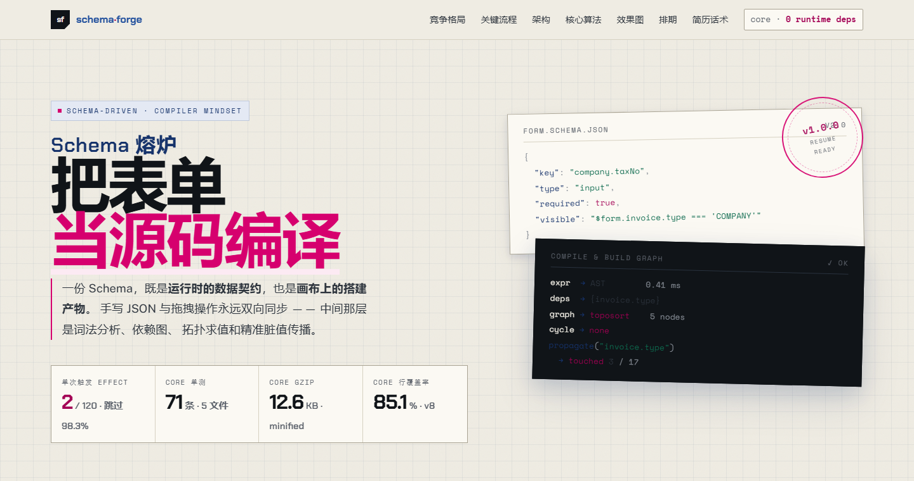
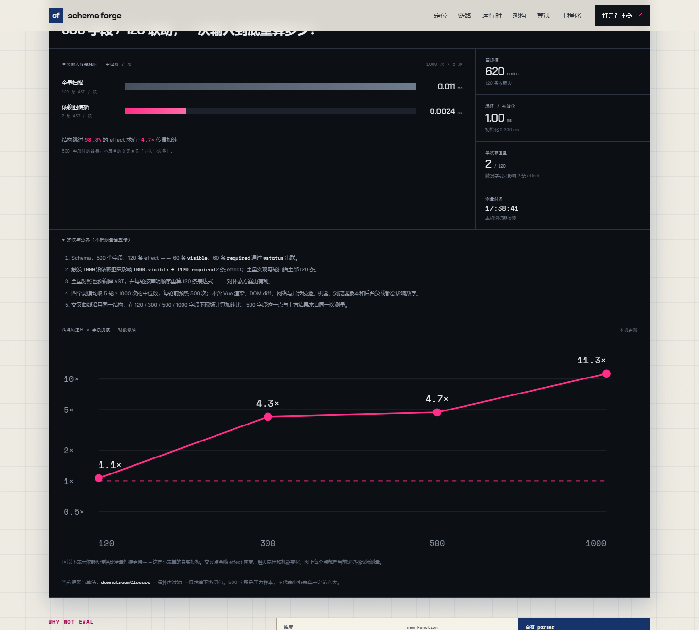

# 我写了一个把 Schema 当源码编译的表单引擎

2026-10-21 · schema-forge



表单引擎通常被当成“解释器”：拿到 JSON Schema，渲染字段，输入时跑一遍表达式，谁依赖谁靠运行时现场判断。这个做法能跑，但当联动变多、字段规模变大、Schema 开始跨版本演进时，问题会集中暴露：

- 每次输入都可能全量扫描表达式，即使只改了一个字段；
- 表达式之间的求值顺序是隐含的，链式联动容易算错；
- 循环依赖往往在运行时才发现，表现为死循环或值来回抖动；
- 用字符串执行表达式（`new Function` / `eval`）会撞上 CSP，也很难精确收集依赖；
- Schema 升级靠 `if (version === '1.0')` 散落在业务代码里。

schema-forge 是一次反向尝试：**先把 Schema 编译成一份运行时程序，再让运行时只做查表和精准求值。** 这篇文章记录它的编译管线、表达式引擎、依赖图、传播策略，以及我为性能数字付出的代价——包括那些最后发现“其实没有更快”的场景。

项目是 TypeScript + Vue 3 + pnpm monorepo，core 不依赖任何框架。

---

## 1. 编译一次，运行很多次

把 Schema 当源码，第一步是明确“编译产物”是什么。在 schema-forge 里是 `FormProgram`：

```ts
export interface FormProgram {
  schema: FormSchema
  layout: NonNullable<FormSchema['layout']>
  fields: FieldNode[]
  allFields: CompiledField[]
  fieldMap: Map<string, CompiledField>
  effects: CompiledEffect[]
  effectMap: Map<string, CompiledEffect>
  rules: CompiledRule[]
  graph: DepGraph
  order: string[]
  cyclic: string[]
  cycles: string[][]
  stats: CompileStats
  issues: CompileIssue[]
  migration: MigrationResult
}
```

它包含字段索引、编译后的 effect、规则、依赖图、拓扑序、环、编译问题、迁移轨迹和统计信息。`createForm()` 既接受原始 Schema，也接受已经编译好的 program——设计器在编辑时只编译一次，预览和运行时复用同一份产物。

编译入口本身是一条直线：

```ts
export function compileSchema(input: unknown): FormProgram {
  const migration = migrateSchema(input)
  const { schema, issues } = normalizeSchema(migration)
  const allFields = flattenFields(schema)
  const effects = compileEffects(allFields, issues)
  const effectMap = new Map(effects.map((effect) => [effect.id, effect]))
  const rules = compileRules(allFields, issues)

  const graph = buildDepGraph({
    fields: allFields.map((field) => field.key),
    effects: effects
      .filter((effect) => !effect.literal && effect.expression)
      .map((effect) => ({ id: effect.id, deps: effectDependencies(effect) })),
  })

  const { order, cyclic } = toposort(graph)
  const cycles = cyclic.length > 0 ? findCycles(graph, cyclic) : []
  // ...把 cycles / issues / stats 组装进 program
}
```

代价也很明确：Schema 改变就要重新编译。设计器里输入属性时，如果每次按键都重编译，右侧预览会明显卡顿。所以画布读的 `schema` 是即时的，编译用的 `compiledSchema` 有 150ms 防抖：

```ts
watch(schema, (next) => {
  scheduleSave()
  if (compileTimer) clearTimeout(compileTimer)
  compileTimer = setTimeout(() => {
    compileTimer = null
    compiledSchema.value = next
  }, 150)
}, { deep: false })
```

这不是“编译没有成本”，而是把成本放到了正确的位置：编辑时允许短暂陈旧，提交或预览时拿到的是一份完整的程序。

---

## 2. 协议：先定义源码，再谈编译

Schema v2.0 是一棵字段树。每个字段可以有 `visible`、`disabled`、`required` 三类状态表达式，`rules` 校验规则，以及 `props`、`layout`、`children`。数组字段的 `children` 是行模板，不是全局数据路径——这个区别后面会直接影响渲染层。

协议演进没有推倒重来，而是维护一条有序迁移链：

```ts
const MIGRATIONS: Migration[] = [
  {
    from: '1.0',
    to: '1.1',
    up(schema) {
      return {
        ...schema,
        version: '1.1',
        fields: schema.fields.map(migrateField),
      }
    },
  },
  {
    from: '1.1',
    to: '2.0',
    up(schema) {
      return {
        ...schema,
        version: '2.0',
        layout: schema.layout ?? DEFAULT_LAYOUT,
        fields: schema.fields.map(migrateField),
      }
    },
  },
]
```

每一级都是纯函数，负责把旧写法翻译成新写法，比如 `visibleWhen: { field, eq }` → `visible: "$form.xxx === ..."`。迁移失败时不覆盖原值，而是保留上一版本并记录 warning：

```ts
try {
  current = migration.up(current)
  current.version = migration.to
  applied.push(`${migration.from} → ${migration.to}`)
} catch (error) {
  warnings.push(`migrate ${migration.from} → ${migration.to} 失败，已保留上一版本：${...}`)
  break
}
```

“迁移失败保留原值”听起来是小事，但它决定了线上老 Schema 出错时是“可诊断的降级”还是“静默丢字段”。

归一化阶段还会处理缺失 key、重复 key、非法字段。重复 key 会被重命名并产生 warning，而不是让后一个字段悄悄覆盖前一个。

---

## 3. 表达式：手写 parser 不是为了炫技

表达式支持路径、三元、逻辑、比较和少量白名单函数：

```text
$form.trip.type === 'INTERNATIONAL'
len($form.employee.name) >= 2
$status.passport.no.visible
includes($form.employee.name, '重名')
```

解析器是词法分析 + **优先级爬升**。核心循环可以压缩成下面这样：

```ts
const parseBinary = (minPrecedence: number): ExprNode => {
  let left = parseUnary()
  while (true) {
    const token = peek()
    if (token.type !== 'operator') break
    const precedence = BINARY_PRECEDENCE[token.value]
    if (precedence == null || precedence < minPrecedence) break
    next()
    const right = parseBinary(precedence + 1)
    left = { type: 'Binary', op: token.value, left, right, ... }
  }
  return left
}
```

为什么不用 `new Function`？三个理由，按重要性排序：

1. **CSP**：政企内网、部分小程序容器、Electron 安全配置会禁用 `unsafe-eval`，`new Function` 直接让页面白屏。
2. **依赖收集**：字符串执行时，依赖只能靠正则猜。字段 key 拼在变量里、条件分支里、函数参数里，正则必漏。而 AST 上的 `Path` 节点是精确的。
3. **错误定位**：手写 parser 能给出行列号，编译问题可以指到具体表达式；`SyntaxError` 通常只有一句“Unexpected token”。

白名单函数只有 `len`、`includes`、`empty`、`sum`、`date`、`upper`、`lower`。不支持方法调用（`.includes()` 会被解析器拒绝），也不存在属性访问逃逸。求值器只认识 AST 节点类型，不认识 JavaScript 作用域。

依赖收集直接遍历 AST：

```ts
export function collectDependencies(ast: ExprNode): Dependency[] {
  const seen = new Set<string>()
  const deps: Dependency[] = []
  walkAst(ast, (node) => {
    if (node.type !== 'Path') return
    if (node.scope === 'self' || node.scope === 'index') return
    if (!node.path) return
    const kind = node.scope === 'status' ? 'status' : 'value'
    const id = `${kind}:${node.path}`
    if (seen.has(id)) return
    seen.add(id)
    deps.push({ kind, path: node.path })
  })
  return deps
}
```

这里有一个容易漏掉的细节：`$self` 没有路径，依赖收集会跳过它。但像 `visible: "$self > 0"` 这样的表达式，字段自己的值变化时必须重算。编译器在 `effectDependencies()` 里单独检查 AST 是否使用了 `$self`，如果是，就把 effect 所属字段补成一条 value 依赖。否则这个 effect 永远不会被触发。

---

## 4. 依赖图：effect 也是节点

只把字段当节点是不够的。`required: "$status.company.taxNo.visible"` 依赖的不是某个字段值，而是另一个 effect 的结果。如果 effect 不是图节点，这种链式联动就没有边。

所以每条状态表达式会生成一个节点，ID 是 `${field.key}.${prop}`：

```ts
for (const prop of ['visible', 'disabled', 'required'] as const) {
  const raw = field.node[prop]
  if (raw === undefined) continue
  const id = `${field.key}.${prop}`
  // ...编译表达式、记录 literal 或 AST、推入 effects
}
```

建图时，字段值是 `value` 节点，状态表达式是 `effect` 节点，依赖边从依赖方指向 effect：

```ts
export function buildDepGraph(spec: {
  fields?: string[]
  effects?: EffectEdgeSpec[]
}): DepGraph {
  const graph = createDepGraph()
  for (const field of spec.fields ?? []) addNode(graph, field, 'value')
  for (const effect of spec.effects ?? []) {
    addNode(graph, effect.id, 'effect')
    for (const dep of effect.deps) {
      addEdge(graph, dep.path, effect.id)
    }
  }
  return graph
}
```

典型的三链在发票 Schema 里长这样：

```text
invoice.type  ──▶  company.taxNo.visible  ──▶  company.taxNo.required
```

当用户把发票类型切到 `COMPANY`，`invoice.type` 的下游闭包包含 `company.taxNo.visible` 和 `company.taxNo.required`。求值时按拓扑序，先算可见，再算必填，顺序不会错。

拓扑排序用 Kahn：

```ts
export function toposort(graph: DepGraph): TopoResult {
  const indegree = new Map<string, number>()
  for (const node of graph.nodes) indegree.set(node, 0)
  for (const targets of graph.adj.values()) {
    for (const target of targets) {
      indegree.set(target, (indegree.get(target) ?? 0) + 1)
    }
  }
  const queue = graph.nodes.filter((node) => (indegree.get(node) ?? 0) === 0)
  const order: string[] = []
  for (let i = 0; i < queue.length; i++) {
    const node = queue[i]
    order.push(node)
    for (const target of graph.adj.get(node) ?? []) {
      const next = (indegree.get(target) ?? 0) - 1
      indegree.set(target, next)
      if (next === 0) queue.push(target)
    }
  }
  const visited = new Set(order)
  const cyclic = graph.nodes.filter((node) => !visited.has(node))
  return { order, cyclic }
}
```

排序后还有入度的节点就是环的参与者。接下来用 DFS 三色标记找具体环路径：

```ts
const visit = (node: string) => {
  color.set(node, GRAY)
  stack.push(node)
  for (const target of graph.adj.get(node) ?? []) {
    const targetColor = color.get(target) ?? WHITE
    if (targetColor === GRAY) {
      const start = stack.lastIndexOf(target)
      if (start !== -1) {
        const cycle = [...stack.slice(start), target]
        // 用规范化后的 key 去重，避免同一个环被报告多次
        found.set(canonicalCycle(cycle), cycle)
      }
    } else if (targetColor === WHITE) {
      visit(target)
    }
  }
  stack.pop()
  color.set(node, BLACK)
}
```

环不会被静默算错，也不会在运行时死循环：它作为 `CIRCULAR_DEPENDENCY` 编译问题返回，设计器里能直接看到 `a → b → a` 的完整路径。

---

## 5. 精准传播：闭包 + 拓扑序

运行时收到 `setValue(path, value)` 后，先做同值短路，再求变更节点的下游闭包：

```ts
export function downstreamClosure(graph: DepGraph, start: string): Set<string> {
  const down = new Set<string>([start])
  const stack: string[] = [start]
  while (stack.length > 0) {
    const current = stack.pop() as string
    for (const target of graph.adj.get(current) ?? []) {
      if (!down.has(target)) {
        down.add(target)
        stack.push(target)
      }
    }
  }
  return down
}
```

闭包是一个集合，但 effect 之间有先后。所以运行时把闭包里的 effect 收集起来，按编译期记录的拓扑位置排序，再依次求值：

```ts
const down = downstreamClosure(program.graph, path)
const pendingEffects = []
for (const node of down) {
  const effect = program.effectMap.get(node)
  if (!effect || effect.literal || !effect.expression) continue
  const position = orderPosition.get(node)
  if (position === undefined) continue
  pendingEffects.push({ effect, position })
}
pendingEffects.sort((a, b) => a.position - b.position)

for (const { effect, position } of pendingEffects) {
  // 求值 → 比较前后值 → 只有变化时才改状态
}
```

版本号用 `Uint32Array`，节点 ID 到下标在编译后固定：

```ts
let versions = new Uint32Array(program.graph.nodes.length)
const nodeIndex = new Map<string, number>()
program.graph.nodes.forEach((node, index) => nodeIndex.set(node, index))

function bump(id: string): boolean {
  const index = nodeIndex.get(id)
  if (index === undefined) return false
  versions[index] = (versions[index] ?? 0) + 1
  return true
}
```

Vue 层不需要知道整张图。`useField` 订阅 store 事件，只有事件里的 `touched` 命中自己的路径时才 bump 本地 tick：

```ts
if (!localStatus) {
  if (event.touched.includes(path.value)) tick.value++
  return
}
```

这让“一个字段输入 → 所有字段重渲染”变成“一个字段输入 → 受影响的字段更新”。性能基准里的结构跳过，本质上就是这套机制的可观测结果。

---

## 6. 数组行：编译图的例外

数组字段的 `children` 是行模板，不能按普通字段编译成全局路径。`flattenFields()` 遇到 `array` 就停止向下展开：

```ts
if (node.children?.length && !isArray) {
  walk(node.children, node.key, depth + 1)
}
```

因此行内字段的 `visible/disabled/required` 不在编译图里，要在渲染层本地求值。这带来两个问题：

**第一，不能每次渲染都深拷贝整份表单值。** 早期的本地求值调用 `getValues()`，它会 `deepClone(values)`；一行有多个 flags，每次渲染就是多次全量克隆。现在 core 提供一个只读视图：

```ts
getValuesView(): Readonly<Record<string, unknown>> {
  return values
}
```

渲染层一次取值，复用同一个 scope，并用缓存好的 AST 求值：

```ts
function localStatus(): FieldStatus {
  const values = props.form.getValuesView()
  const scope: EvaluationScope = {
    form: values,
    values,
    self: props.form.getValue(path.value),
    index: props.index ?? 0,
    resolveStatus,
  }
  // 三个 flag 复用同一个 scope，不再重复拷贝
}
```

**第二，不能因为任意一行变化就重渲染所有行。** 行内 flags 可能依赖全局 `$form` 值，也可能依赖 `$status`，所以只按行路径过滤会漏更新。`FieldNode` 把“行路径 + flag 表达式的静态依赖”一起传给 `useField`：

```ts
const localScope = computed<LocalFieldScope>(() => ({
  path: props.prefix === undefined ? undefined : `${props.prefix}[${props.index ?? 0}]`,
  dependencies: localDependencies.value,
}))
```

`useField` 用 `overlaps()` 判断 touched 路径与当前字段、行路径、依赖路径是否有祖先/后代关系：

```ts
const affected = event.touched.some((touched) =>
  overlaps(touched, current) ||
  (scope.path !== undefined && overlaps(touched, scope.path)) ||
  (scope.dependencies ?? []).some((dependency) => overlaps(touched, dependency)),
)
if (affected) tick.value++
```

这样既不会一行输入导致所有行重渲染，也不会因为漏订阅导致状态陈旧。`reset` 事件则无条件 bump，避免重置后行内状态停留在旧值。

---

## 7. 迁移链与 Patch 历史

除了迁移，设计器还需要撤销重做。实现没有存整份 Schema 快照，而是存 RFC 6902 JSON Patch：

- 每次编辑用 `diff(prev, next)` 得到最小补丁；
- 同时计算反向补丁，压入历史栈；
- 同一 `mergeKey` 的连续编辑在 300ms 窗口内合并；
- 历史栈上限 200 步；
- 撤销时应用反向补丁，重做时应用正向补丁。

```ts
if (
  options.mergeKey &&
  last &&
  last.mergeKey === options.mergeKey &&
  timestamp - last.timestamp <= this.mergeWindow
) {
  last.patch.push(...patch)
  last.inverse = [...inverse, ...last.inverse]
  last.timestamp = timestamp
} else {
  this.undoStack.push({ patch, inverse, mergeKey: options.mergeKey, timestamp })
  if (this.undoStack.length > this.limit) this.undoStack.shift()
}
```

Patch 的好处不只是省内存：它是可序列化、可传输的增量。将来接协同编辑时，网络上传输的本来就是 patch，不需要把架构从“快照同步”改成“操作同步”。

---

## 8. 设计器：用表单引擎配置表单引擎

设计器的属性面板不是手写的表单，而是用同一套 `SchemaRenderer` + 物料 `propsSchema` 渲染出来的。也就是说，引擎在配置它自己。

- 物料注册表提供控件类型、默认值和属性字段的 Schema；
- 选中画布节点后，属性面板的输入通过同一套表达式、校验和 store 更新；
- 每次修改生成 patch，进入历史栈；
- 画布、逻辑板、预览、JSON 编辑共享同一份 Schema。

这是一个很好的自举测试：如果协议设计有缺口，属性面板会第一个暴露。比如某个物料属性需要联动，属性面板自己就得用 `visible` 表达式；某个字段需要数组，面板就得支持数组容器。引擎必须先能满足自己，才有资格谈“通用”。

设计器的编译防抖也是在这里落地的：属性输入即时反映到画布，但依赖图和编译问题 150ms 后才更新。用户不会因为每个按键都重建图而看到明显卡顿。

---

## 9. 基准：先承认小表单不会更快

这部分是我在复验项目时改动最大的地方。最初计划书里写了一些很漂亮的数字：480ms → 9.4ms、首屏 2100ms → 380ms、DOM 8400 → 610。实际检查后发现，其中一部分根本没有实现（虚拟滚动），另一部分是把不同场景的数字拼在了一起。这些数字最后全部删掉或改成了实测值。

现在首页的基准是现场构建 Schema 并测量的：

```ts
const ITERATIONS = 1000
const ROUNDS = 5
const WARMUP = 500
const SWEEP_SCALES = [
  { fields: 120, triggers: 10 },
  { fields: 300, triggers: 30 },
  { fields: 500, triggers: 60 },
  { fields: 1000, triggers: 120 },
]
```

500 字段样本包含 120 条 effect：60 条可见性、60 条必填，后者通过 `$status` 串联。触发 `f000` 时，依赖图只让 `f100.visible → f200.required` 这 2 条 effect 进入求值；全量对照实现每轮扫描全部 120 条。两者都预编译 AST，后者按声明顺序全量重算——这个对照对朴素实现更有利。

结果不是“永远更快”。在 120 字段的小样本上，依赖图传播的固定开销和全量扫描差不多，实测约 1.1×；字段规模上来后差距才拉开。500 字段处多次测量落在 4.2×–7.4× 之间，1000 字段可以到 10× 以上。机器、浏览器版本、后台负载都会影响结果，所以页面同时画了交叉曲线，并明确标注：**小表单可能没有收益，甚至略慢。**



基准只测 core 的传播路径，不包含 Vue 渲染、DOM diff、网络与异步校验。它回答的问题是“结构跳过了多少 effect 求值”，不是“整个页面快了多少”。500 字段是压力样本，不代表业务表单都这么大。

我把这段写进 README 和首页，是因为性能数字一旦脱离测量条件，就会变成营销。更糟的是，它会让后续优化失去基准：你不知道自己到底在优化什么。

---

## 10. 工程化：让结论可复跑

项目没有停留在“能演示”。当前的工程状态：

- **71 条 core 单测 / 5 个文件**：表达式、图、Patch、协议、store；
- **行覆盖率 85.1%**，分支 74.0%，函数 85.3%（v8）；
- **core 35.4 KB → 12.6 KB gzip**，tsdown 输出 ESM + CJS + `.d.ts`，开启 minify；
- **0 运行时依赖**，core 不依赖 Vue、DOM 或任何第三方库；
- **CI 两个 job**：quality 跑 install → typecheck → test → build 并上传构件，pages 在 main 分支下载同一份构件并发布到 GitHub Pages。

core 不依赖 DOM，带来的直接好处是测试可以直接构造 Schema、编译、求值，不需要挂载组件或模拟浏览器。图算法、迁移链、Patch 都是纯函数，测试失败时定位成本很低。

CI 里有一个细节：pages job 不重新 install + build，而是下载 quality 上传的 `playground-dist`。这保证线上部署的就是刚才通过测试的那份产物，而不是“另一个环境下重新构建的版本”。

---

## 11. 没做完的部分

把边界写清楚，比把路线图写成已完成更有价值：

- **没有虚拟滚动**，长表单的 DOM 节点数没有优化，也没有首屏测量数据；
- **没有增量编译**，Schema 改动仍要重建整张图；
- **没有发布 npm 包**，没有 changesets / size-limit；
- **只有 Vue 渲染器**，`renderer-react` 仍是路线图；
- **没有后端协作**，设计器状态存在 `localStorage`；
- **竞品对比只是基于公开文档的粗粒度定位**，不是评测。

这些缺口不影响“编译 Schema”这个核心命题的完整性，但会影响它作为一个通用产品的成熟度。文章和 README 都不应该假装它们不存在。

---

## 12. 写完之后

如果让我总结这次实现里最重要的三个决定：

1. **先定义编译产物，再写运行时。** `FormProgram` 定清楚之后，表达式、图、store、渲染层都有了稳定接口。反过来先写组件、再补引擎，很容易把运行时逻辑散落到渲染层。
2. **把 effect 当成图节点。** 只对字段建图，`$status` 链就没有边；把 effect 加进去，链式联动、环检测和拓扑求值才能统一处理。数组行则是明确的例外：它们是行模板，不是全局路径，必须在渲染层本地求值，同时用静态依赖保证订阅正确。
3. **性能结论必须带条件。** 依赖图在 500 字段上能跳过 98.3% 的 effect 求值，但在 120 字段的小表单上可能只有 1.1×。承认交叉点，比宣称“全面加速”更接近工程事实。

项目地址与运行方式在 [README](../README.md)。如果你也在做 Schema 驱动的表单或低代码平台，欢迎从编译管线、依赖图或 Patch 历史里挑一块交流。
